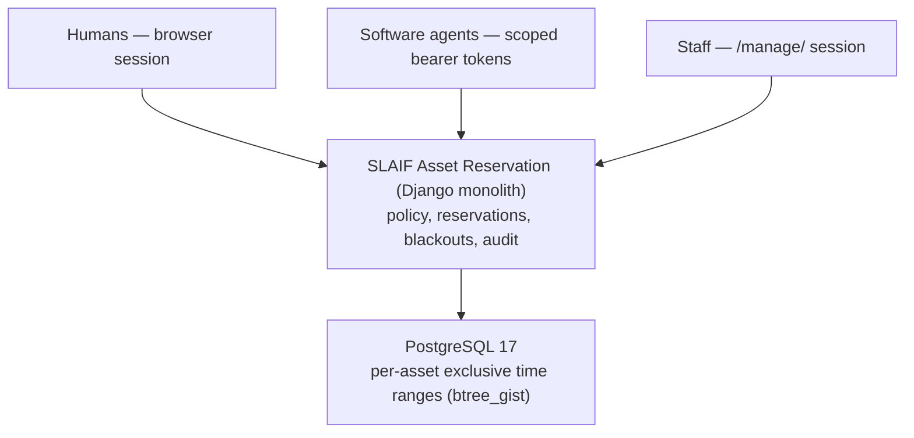

<div align="center">
  <a href="https://www.slaif.si">
    
  </a>
</div>

# SLAIF Asset Reservation

<div align="center">

[](https://github.com/ulfe-lmi/slaif-asset-reservation/actions/workflows/ci.yml)
[](https://www.python.org/)
[](LICENSE)

**A single reservation authority for shared laboratory assets — for both
authenticated humans and authenticated software agents.**

</div>

SLAIF Asset Reservation gives researchers and their tools one conflict-free
way to book exclusive laboratory resources — including compute workstations,
microscopes, fabrication equipment, instruments and bookable services.
The bundled demo is entirely fictitious. A reservation accepted by the system is:

- **conflict-free** for its asset and time range — exclusivity is enforced
  by PostgreSQL, not by application checks alone;
- **policy-gated** — duration, lead time, horizon, purpose and per-principal
  counters under the active policy, failing closed when no policy applies;
- **attributable** to an authenticated principal (human account or scoped
  API token);
- **auditable** — every lifecycle transition is recorded atomically with its
  domain mutation;
- **cancellable or releasable** — the owner or permitted staff can cancel
  or release it through explicit, audited transitions.

## Get started

- **Testing on this computer? [QUICKSTART.md](QUICKSTART.md)** — local
  Docker evaluation in roughly 5–10 minutes, with optional fictitious demo assets.
- **Need access from another computer or the Internet? [INSTALL.md](INSTALL.md)**
  — authenticated HTTPS deployment, protected secrets, proxy, backup and recovery.
  Remote users connect to the HTTPS hostname; the application port remains
  host-loopback-only behind the proxy.

## How it works



One application owns the scheduling records and the authoritative domain
operations. Humans reserve through the server-rendered web UI; agents use a
versioned REST API with scoped, expiring tokens and idempotent mutations;
staff configure policies, maintenance blackouts and cross-user lifecycle
through a separate management area. Reservations are **entitlements**: the
system deliberately does not run jobs, allocate hardware, or enforce usage —
that is the boundary of a future, separate execution gateway.

A fresh installation initializes the global `default` policy: reservations may
start within the next **7 days** and last **1 minute to 48 hours**, with no extra
lead time, advance cancellation cutoff, operating-hour window or required purpose.
Staff can inspect and adjust policies in management. Existing policy
configurations are preserved on upgrades.

## What you can do

| Client | Capabilities |
| --- | --- |
| **Humans (browser)** | Browse active assets, see privacy-safe advisory availability, create / cancel / release own reservations, manage own API tokens (one-time display), set display name and timezone. Accounts are administrator-created; there is no self-registration. |
| **Agents (API)** | `/api/v1/me/`, per-asset advisory availability, and owner-scoped reservation list / detail / create / cancel / release with bounded `Idempotency-Key` mutations and machine-readable problem details. Contract: [docs/api-contract.md](docs/api-contract.md). Asset list/detail endpoints remain staff-session-only — a token alone grants no asset discovery. |
| **Staff (management)** | `/manage/`: reservation policies, coarse maintenance blackouts, cross-user reservation inspection and lifecycle, audit review and bounded export. Operational: `/health/live`, `/health/ready`, `operational_check`, `pilot_readiness_check`, backup/restore tooling. |

## Supported runtime

- **Python 3.13**, **Django 5.2** (locked 5.2.17), **DRF** (locked 3.17.2),
  **PostgreSQL 17**; dependencies locked in `uv.lock`.
- **Docker Compose** on a single Linux host (`linux/amd64` is the supported
  and verified architecture): loopback-only development Compose, and a
  production-shaped example (non-root `10001:10001`, read-only root
  filesystem) behind an HTTPS reverse proxy.
- Internet-reachable authenticated service through an operator-owned HTTPS
  reverse proxy. Gunicorn stays private/loopback; PostgreSQL stays on the private
  Compose network. Explicit proxy trust, secure cookies, host/origin validation
  and shared PostgreSQL login/API abuse budgets form the supported boundary.
- SLAIF browser design with local fonts and images; optional read-only
  [logo, favicon, image and CSS overrides](docs/branding.md) require no image rebuild.
  Generated OpenAPI schema uses locally served Swagger UI.

## Documentation

| Topic | Document |
| --- | --- |
| Canonical architecture | [ARCHITECTURE.md](ARCHITECTURE.md) |
| Local Docker evaluation | [QUICKSTART.md](QUICKSTART.md) |
| Installation and deployment (operator) | [INSTALL.md](INSTALL.md) |
| API contract (`/api/v1/`) | [docs/api-contract.md](docs/api-contract.md) |
| Human UI | [docs/human-ui.md](docs/human-ui.md) |
| Domain model and time semantics | [docs/domain-model.md](docs/domain-model.md) |
| Deployment reference | [docs/deployment.md](docs/deployment.md) |
| Security model | [docs/security-model.md](docs/security-model.md) |
| Appearance customization | [docs/branding.md](docs/branding.md) |
| Visual design and typography | [docs/ux/visual-design.md](docs/ux/visual-design.md) |
| Testing and verification | [TESTING.md](TESTING.md) |
| OpenAPI schema and Swagger UI | `/api/schema/` and `/api/docs/`, enabled by `SLAIF_ENABLE_API_DOCS` (disabled by default in production; staff-only there when enabled) — [docs/deployment.md](docs/deployment.md#4-configuration) |
| Operator runbooks and readiness gates | [docs/runbooks/](docs/runbooks/) |
| Architecture decision records | [docs/decisions/](docs/decisions/) |
| Full documentation index | [docs/README.md](docs/README.md) |

## Important limitations

- **Controlled authenticated pilot.** Internet reachability relies on the full
  [HTTPS/proxy installation contract](INSTALL.md). Application abuse budgets
  complement perimeter protection; they do not stop distributed or volumetric
  attacks, and this is not a claim of unrestricted production maturity.
- **Broad member access:** project/group resource authorization is not implemented.
  Every active human account can browse active assets and request any reservable
  exclusive asset with an effective policy. Create accounts accordingly.
- No OIDC, self-registration, password reset, email or notifications. Accounts are
  administrator-created; service accounts cannot use the human login UI.
- Reservations grant entitlements; the service does not execute workloads,
  allocate hardware, enforce actual usage or integrate a scheduler/gateway.
- Runtime and migrations share a privileged PostgreSQL role. Scheduled/off-host
  backups, restore drills, monitoring and incident response need operator ownership.
  Real private SmartScheduling cutover remains a separate supervised operation.

## Developers

Python 3.13 with `uv` (locked dependencies) and a local PostgreSQL 17:

```bash
docker compose -p slaif-asset-reservation-dev up -d db
uv sync --locked --all-groups
cp .env.example .env
uv run --env-file .env python manage.py migrate
uv run --env-file .env python manage.py initialize_default_policy
uv run --env-file .env python manage.py runserver
```

Standard verification commands are in [TESTING.md](TESTING.md); contribution
rules in [CONTRIBUTING.md](CONTRIBUTING.md).

## License

[Apache License 2.0](LICENSE).

This work is associated with the
[Slovenian AI Factory (SLAIF)](https://www.slaif.si) and acknowledges support
from the European Commission/EuroHPC Joint Undertaking and the Slovenian
Ministry of Higher Education, Science and Innovation for SLAIF grant
`101254461`.

---

Development in this repository runs under the Codex-only **Concentrated OAP**
workflow: the root [AGENTS.md](AGENTS.md) routes agent roles,
[docs/oap-workflow.md](docs/oap-workflow.md) describes the live workflow, and
orders and immutable reports live under `oap/`. Earlier work-order history is
preserved for reference under [docs/work-orders/](docs/work-orders/) and
[docs/project-handoff.md](docs/project-handoff.md).
