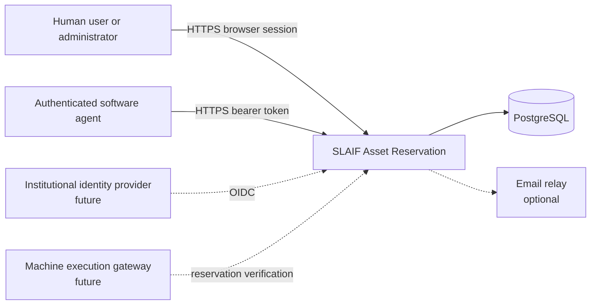
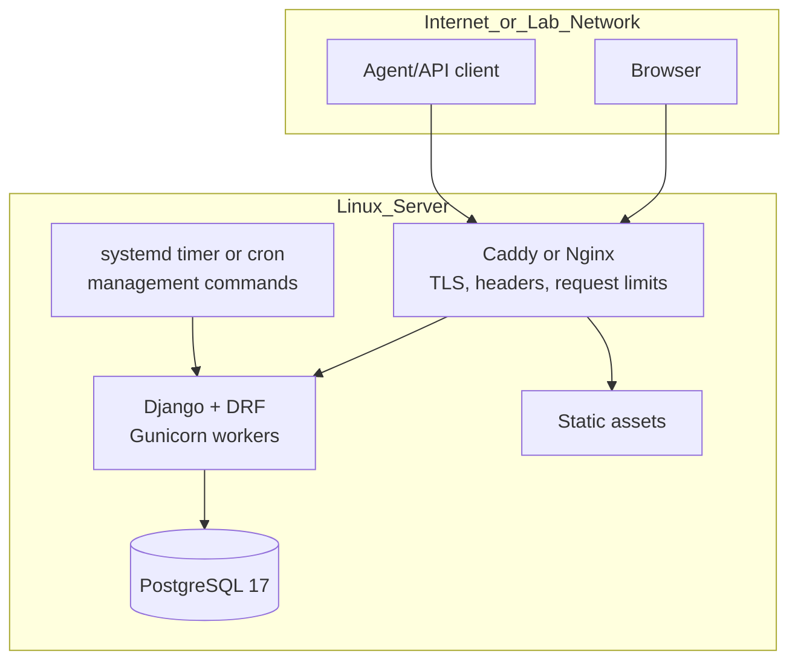

# Architecture

**Status:** Accepted baseline
**Scope:** reservation authority; execution gateways are future integrations

## 1. System context



The reservation application is the source of truth for entitlement. It does not launch tasks or enforce physical exclusivity on a host. A future gateway may rely on its signed/authenticated decision while still checking real machine state.

## 2. Container architecture



Initial deployment is one application service plus PostgreSQL. The reverse proxy terminates TLS and applies conservative request limits. Static assets may be served by the proxy or WhiteNoise, chosen and tested in the scaffold PR.

## 3. Application modules

| Module | Responsibility | Must not own |
|---|---|---|
| `accounts` | custom user, projects/groups, memberships, roles, API tokens | scheduling decisions |
| `assets` | machines, child assets, capabilities, tags, availability/blackouts | reservations for users |
| `reservations` | policies, reservation commands, conflict handling, lifecycle | HTTP serialization |
| `audit` | append-only security/domain event evidence | secrets or full sensitive payloads |
| `api` | `/api/v1`, serializers, authentication adapters, OpenAPI | duplicated business rules |
| `web` | human views, forms, templates, progressive enhancement | duplicated business rules |
| `config` | settings, URLs, ASGI/WSGI, health integration | domain models |

The web and API layers invoke the same command/query services. Django admin is an early operational interface, not the final human product.

## 4. Request flows

### 4.1 Create reservation

```mermaid
sequenceDiagram
    participant C as Browser or API client
    participant V as Web/API adapter
    participant S as Reservation service
    participant P as Policy evaluator
    participant D as PostgreSQL
    participant A as Audit writer

    C->>V: create(asset, start, end, purpose)
    V->>S: validated command + principal
    S->>P: effective policy
    P-->>S: allow or reasoned denial
    S->>D: BEGIN; insert reservation
    D-->>S: success or exclusion violation
    S->>A: append audit event in transaction
    S->>D: COMMIT
    S-->>V: reservation or conflict/policy error
    V-->>C: HTML response or API problem detail
```

The Work Order 0003 implementation provides this domain service layer. Work Order 0004 exposes it
through server-rendered member pages only; reservation REST/API mutations remain deferred.
`create_reservation`, `cancel_reservation`, and `release_reservation` run inside
transactions and append audit evidence in the same transaction. Creation normalizes `now`,
`start_at`, and `end_at` to UTC before comparison or storage, then locks rows in this order:
requesting principal, authoritative asset, selected effective policy. Cancellation normalizes the
server clock and locks requester, reservation, asset, and selected policy before applying the cutoff.
This prevents a policy update from committing midway through an operation that already selected that
policy. Release is entitlement-reducing: it locks the requester, reservation, and asset for
consistency but does not require the asset to remain active/reservable and does not require an
effective policy to still exist.

The application performs an early overlap query for useful feedback, but PostgreSQL remains the
final arbiter. Only a PostgreSQL diagnostic constraint name exactly equal to
`reservation_no_overlap_per_asset` is translated to the stable `reservation_conflict` domain code;
unrelated integrity errors propagate for operator investigation.

The human-session adapter in `web` validates form shape, local wall time, ownership, and CSRF, then
calls these services with `source="web"`. It maps stable domain error codes to safe form/messages
without exposing SQL, constraint names, stack traces, or another user's reservation details.

### 4.1.2 API token lifecycle

Token issuance and revocation are explicit account services, not view or admin shortcuts. Issuance
locks the active human owner, validates scope/lifetime/name, generates the bearer secret, stores only
the verifier and lifecycle metadata, and appends `api_token.created` audit evidence in the same
transaction. Revocation locks owner then token, is owner-only in this slice, preserves token history,
and appends `api_token.revoked` once. If audit append fails, the token mutation rolls back.

### 4.1.1 Human availability reads

Work Order 0004 adds reusable availability query logic for the member UI. It takes an asset,
principal, local start date, 1-7 day window, display timezone, and injectable `now`. It resolves
asset state and effective policy, queries confirmed/released blocking reservations with
`[start_at, effective_end_at)` semantics, clips and merges busy intervals, and computes privacy-safe
free intervals that can satisfy the policy minimum duration, lead time, and horizon. Cancelled
reservations do not block. Results expose another user's busy time only as `Unavailable`; identity,
email, purpose, cancellation reason, and reservation UUID remain hidden.

### 4.2 Agent API authentication

Work Order 0005 implements the token lifecycle and a DRF bearer-authentication primitive. Work Order
0006 enables that authenticator only on the new bearer-token endpoints; it is still not registered
globally. Verification:

1. parses the strict `sar_<token_uuid_hex>_<secret>` grammar without logging the token;
2. locates the token by public UUID locator;
3. derives an HMAC-SHA-256 verifier over the complete bearer token using
   `SLAIF_API_TOKEN_PEPPER`;
4. compares in constant time;
5. verifies owner active state, service-account denial, revocation, and exclusive expiry;
6. returns `(owner_user, api_token)` to future DRF adapters;
7. updates `last_used_at` best-effort without making authentication depend on that write.

Plaintext token storage is forbidden. Work Order 0006 binds this authenticator to scoped `/me`,
availability, and owner reservation endpoints and records idempotency evidence for mutations.

### 4.2.1 Staff management adapter

Work Order 0007 adds server-rendered `/manage/` routes for active staff users, excluding service
accounts. Management routes are separate from ordinary member routes; staff users on member pages
remain owner-scoped. Management mutations use POST plus CSRF and call audited/domain services:

1. validate active staff access;
2. validate form input, including explicit local wall-time parsing for blackouts;
3. call the policy, blackout, cancellation, or release service inside its transaction boundary;
4. append audit evidence in the same transaction where practical;
5. show safe form or message feedback without exposing SQL, constraint names, or hidden user data.

Active maintenance blackouts are checked inside reservation creation after asset/policy validation
and before insertion. They also feed the shared availability service as privacy-safe unavailable
intervals. The PostgreSQL reservation exclusion constraint remains unchanged and continues to govern
reservation-vs-reservation conflicts.

### 4.2.2 API adapter flow

Bearer-token API views follow this order:

1. authenticate the API token with the dedicated pepper verifier;
2. check the endpoint's required scope;
3. validate request serializers and path identifiers;
4. validate or create an idempotency record for mutations;
5. call the authoritative reservation or availability service;
6. store only a safe replay response for idempotent mutation success or mapped domain result;
7. return problem-details JSON for failures with a correlation ID.

The API adapter does not duplicate policy, overlap, cancellation, or release rules. PostgreSQL and
the reservation domain service remain authoritative.

### 4.3 Early release

1. Principal requests release of an owned active reservation.
2. Service checks ownership/staff authority and current time against UTC-normalized instants.
3. Reservation transitions to `released` with `released_at` and an audit event.
4. Released reservations no longer block future allocation.
5. Historical start/end and original requested end remain inspectable.

Release reduces entitlement and frees the future remainder. It remains available to an authorized
owner or active staff user even if the asset has since been deactivated or the original effective
policy has been deactivated. Cancellation remains policy-aware because it evaluates the configured
cutoff before the reservation starts.

## 5. Persistence and consistency

### PostgreSQL is mandatory

PostgreSQL provides:

- transactional consistency across reservation and audit writes;
- timestamp-with-time-zone and range semantics;
- GiST exclusion constraints for overlap prevention;
- row locking where necessary for idempotency and policy counters;
- JSONB for bounded capability/provenance metadata;
- reliable migrations and backup tooling.

SQLite may be used only for isolated pure-unit tests that do not claim database-invariant coverage. The normal development and CI test path uses PostgreSQL.

### Reservation interval

Intervals use `[start_at, effective_end_at)` semantics, as accepted in ADR 0007. Adjacent
reservations are valid. Confirmed and released reservations participate in an exclusion constraint
equivalent to:

```text
asset_id WITH =
reservation_range WITH &&
WHERE status IN blocking statuses
```

The implemented constraint uses `TSTZRANGE(start_at, effective_end_at, '[)')` with GiST operators
after installing PostgreSQL `btree_gist`.

### Idempotency

Mutating API requests accept `Idempotency-Key`. The database stores a scoped request record containing:

- principal/token identity;
- endpoint/action;
- normalized request hash;
- response status and safe result reference;
- creation/expiry timestamps.

Same key + same request returns the prior result. Same key + different normalized request returns a conflict. Browser forms use normal CSRF and duplicate-submit protection; they may reuse the same domain mechanism where useful.

## 6. Authentication and authorization

### Human authentication

MVP uses the custom Django user model and secure session login. Only active, non-service-account
users may use member routes. Accounts are administrator-created; self-registration, password reset,
OIDC, and social authentication are deferred. The model is designed for later OIDC association
without replacing user primary keys.

Production target is institutional OIDC when provider details are known. OIDC is deferred rather than guessed.

### Agent authentication

Agents receive API tokens with:

- owner and optional project/service-account identity;
- token prefix/identifier;
- one-way verifier;
- explicit scopes;
- optional asset/tag restrictions;
- expiry and revocation timestamps;
- safe last-used metadata.

Suggested initial scopes:

```text
assets:read
availability:read
reservations:read
reservations:create
reservations:cancel
reservations:release
```

Administrative API scopes are not part of the first agent API.

### Authorization

Authorization combines:

- authenticated principal;
- role and group/project membership;
- token scopes and restrictions;
- asset state and policy;
- reservation ownership;
- action and time.

A centralized policy/service layer returns structured decisions. Views and serializers do not reproduce the rules.

## 7. Human interface

Use server-rendered templates. Progressive enhancement may improve filtering, availability refresh, and modal/form interactions, but core operations must work without a JavaScript-only architecture.

A dedicated UI ADR may select local CSS and calendar components. Do not load third-party scripts from arbitrary CDNs in production without review.

See `docs/human-ui.md`.

## 8. API

- base path `/api/v1/`;
- JSON requests/responses;
- bearer-token authentication for agents;
- session authentication may support same-origin interactive API documentation, but browser UI does not depend on it;
- RFC problem-details-style error envelope;
- cursor or limit/offset pagination chosen consistently;
- generated OpenAPI endpoint and checked-in release artifact if useful;
- mutations require idempotency for agent clients;
- no silent breaking change within v1.

See `docs/api-contract.md`.

## 9. Background work

The initial system has no always-on queue.

Use idempotent management commands for:

- expiring housekeeping records;
- reminder/notification batches if later approved;
- inventory import/export;
- reconciliation checks;
- audit retention tasks after policy is defined.

Run them under systemd timers or cron. Introduce a queue only when latency, retry, or volume evidence justifies it and an ADR defines operational ownership.

## 10. Observability

Minimum operational signals:

- `/health/live`: process responds; no database dependency;
- `/health/ready`: database connection and required migration state are usable;
- structured application logs with correlation ID, actor ID, route, status, duration, and safe error code;
- counters for successful/failed reservation attempts, conflicts, auth failures, and token use;
- database backup status outside the app;
- no tokens, cookies, passwords, private notes, or full request bodies in logs.

Metrics backend selection is deferred; logs and health checks are required first.

## 11. Deployment and network boundary

Production-like deployment:

```text
Internet or institutional network
  -> HTTPS reverse proxy
     -> Django web container/service
        -> PostgreSQL on private network
```

- PostgreSQL is not publicly exposed.
- Django debug mode is off.
- allowed hosts, trusted origins, secure cookies, HSTS, proxy headers, and upload/request limits are explicit.
- administrative access may be restricted by network/VPN in addition to application authorization.
- secrets live outside Git in a root-readable environment/secrets mechanism.
- backups are encrypted and restore-tested.

## 12. Extension points

### Execution gateway

A future gateway receives a reservation ID and asks a minimal internal verification endpoint whether:

- reservation exists and is active now;
- principal is entitled;
- asset matches;
- gateway audience is correct.

The gateway remains responsible for local process isolation, GPU selection, and physical-state validation.

### Inventory probe

A future probe can submit signed observations such as hostname, GPU UUID, driver state, and availability. Observations are not reservation entitlement and must not silently rewrite administrator-approved identity.

### Atomic allocation

After exact reservation is stable, a transaction-safe allocation endpoint may select an asset matching capability filters and reserve it in one operation. This avoids agent-side find/create races across equivalent assets.

## 13. Rejected alternatives

### Reuse SmartScheduling

Rejected because the domain, authentication, automation, migration, and policy boundaries are wrong.

### FastAPI-only backend

Rejected for the initial product because mature human authentication, forms, admin, sessions, and integrated ORM/migrations are central. FastAPI remains suitable for future deterministic machine gateways.

### JavaScript SPA

Rejected for the first release because it adds a second application stack, duplicate validation pressure, and more deployment/build surface without a demonstrated need.

### Microservices

Rejected because reservation creation requires simple transactional consistency and the deployment team benefits from one service.

### Slurm as the reservation UI/API

Not adopted as the universal product because assets are scattered and not necessarily under one scheduler. Future adapters may integrate scheduler-backed resources.

## 14. Architecture fitness checks

CI and review should eventually enforce:

- no reservation write path bypasses the domain service;
- no SQLite-based test is counted as proof of PostgreSQL conflict behavior;
- no plaintext API-token field exists;
- migrations contain the expected exclusion constraint;
- OpenAPI generation succeeds;
- API and web tests exercise the same policy outcomes;
- no production dependency is added without PR justification;
- no execution/SSH logic enters the core monolith without an ADR.
