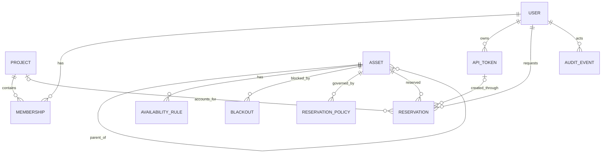
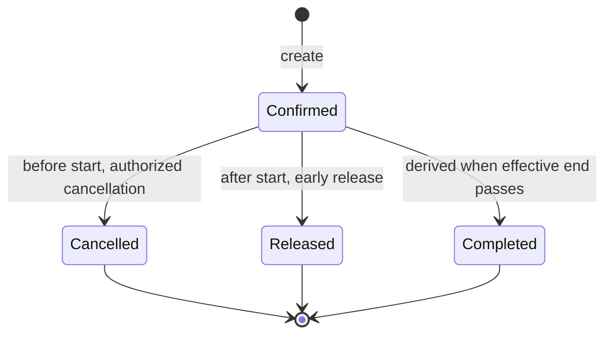

# Domain Model

**Status:** design contract; field names may be refined by an ADR-backed implementation PR

## 1. Modeling principles

- Model laboratory assets, not salon employees.
- Model duration as a time range, not a service/product.
- Use stable UUID identity; names and legacy IDs are mutable metadata.
- Keep human and agent reservations in one table and one lifecycle.
- Make exclusive overlap a database invariant.
- Keep historical facts and audit events; avoid destructive edits.
- Keep execution and physical-state observations separate from entitlement.

## 2. Entity relationship overview



## 3. User

Use a custom user model from the first migration.

Suggested fields:

- `id: UUID`
- `email: case-insensitive unique`
- `display_name`
- `is_active`
- `is_staff`
- `is_service_account`
- `timezone`, default `Europe/Ljubljana`
- standard password/session fields where local auth is enabled
- optional future OIDC subject/provider linkage in a separate identity table
- `created_at`, `updated_at`

Do not make legacy phone number a required user attribute.

## 4. Project and membership

`Project` groups users and may later carry quota/policy context.

Suggested fields:

- `id: UUID`
- `slug`, `name`, `description`
- `active`
- `created_at`, `updated_at`

`Membership`:

- `project_id`
- `user_id`
- role: `member`, `manager`
- unique `(project_id, user_id)`

Django groups may still represent global roles; project membership is domain data.

## 5. API token

Suggested fields:

- `id: UUID`
- `owner_user_id`
- optional `project_id`
- `name`
- non-secret `prefix`
- `verifier` containing an HMAC-derived digest or reviewed password-hash representation
- `scopes` as a validated list or normalized relation
- optional resource/tag restrictions
- `expires_at`
- `revoked_at`, `revoked_by`
- `last_used_at`
- `created_at`

Token plaintext is returned once and is never recoverable. The verifier secret/pepper is supplied outside the database and differs from Django `SECRET_KEY`.

## 6. Asset

Assets form a shallow hierarchy. Initial pattern:

```text
Machine: Neumann
  GPU: Neumann GPU 0
  GPU: Neumann GPU 1
  GPU: Neumann GPU 2
  GPU: Neumann GPU 3
```

Suggested fields:

- `id: UUID`
- `parent_id: nullable self-reference`
- `slug: stable human-readable unique key`
- `name`
- `kind`: `machine`, `gpu`, `cpu_pool`, `service`, `other`
- `booking_mode`: initially `exclusive`
- `description`
- `location`
- `timezone`
- `active`
- `reservable`
- `capabilities: JSONB` with schema-validated keys
- `legacy_source`, `legacy_id`
- `created_at`, `updated_at`

Examples of normalized capability keys after administrator verification:

```json
{
  "vendor": "NVIDIA",
  "model": "A100-SXM4-80GB",
  "memory_gib": 80,
  "accelerator_family": "ampere"
}
```

Do not populate physical identifiers by guessing from legacy usernames or display order.
`physical_locator` is internal administrator metadata, not a public normalized capability.

Work Order 0002 implemented the initial `Asset` and `AssetTag` schema with these refinements:

- `AssetTag`: UUID primary key, unique `slug`, `name`, optional `description`, timestamps.
- `Asset`: UUID primary key, nullable `parent` protected from deletion, unique `slug`, `name`,
  `kind`, exclusive-only `booking_mode`, `description`, `location`, `timezone`, `active`,
  `reservable`, JSON `capabilities`, `verification_required`, internal `physical_locator`,
  optional paired `legacy_source`/`legacy_id`, bounded JSON `legacy_metadata`, tags, timestamps.
- The first-release hierarchy is limited by validation to machine -> child. Machines cannot have
  parents and children must have a machine parent.
- Imported bootstrap rows keep normalized `capabilities` empty until administrator verification.
- `physical_locator`, legacy IDs, and raw legacy metadata are internal/admin provenance and are not
  exposed by the temporary staff-only read API.

## 7. Availability rule

Availability rules describe when an asset is normally reservable.

MVP can default compute assets to 24/7 and still model explicit rules for future use.

Suggested fields:

- `id: UUID`
- `asset_id`
- weekday or recurrence representation limited to weekly rules
- local `start_time`, `end_time`
- timezone inherited or explicit
- effective date range
- active flag

Avoid a generic recurrence engine in v1. Exceptions use `Blackout`.

## 8. Blackout

Represents maintenance or administrative unavailability.

Fields:

- `id: UUID`
- `asset_id`
- `start_at`, `end_at`
- reason and safe public description
- `created_by`
- optional affected-reservation resolution state
- `created_at`

Blackouts use the same half-open time semantics. Creating a blackout does not silently delete conflicting reservations.

## 9. Reservation policy

Start with deterministic, explicit fields rather than a generic expression language.

Suggested fields:

- `id: UUID`
- optional `asset_id` or asset-group/tag target
- priority/specificity handled by a documented resolution order
- `min_duration_minutes`
- `max_duration_minutes`
- `booking_horizon_days`
- `min_lead_minutes`
- `cancellation_cutoff_minutes`
- `max_upcoming_per_principal`
- `max_concurrent_per_principal`
- `purpose_required`
- optional allowed projects/groups
- active/effective dates

Work Order 0003 implements `ReservationPolicy` with UUID identity, optional asset target, active
flag, min/max duration, booking horizon, lead time, cancellation cutoff, upcoming/concurrent
principal limits, purpose requirement, and timestamps. A `NULL` asset is the active global policy.
No project, group, tag, or effective-date targeting exists in this slice.

Policy targets may be the global policy, a machine, or any specific child asset such as a GPU,
CPU pool, or service. Orphan non-machine assets are rejected as policy targets.

Implemented resolution order:

1. asset-specific active policy;
2. nearest parent-machine policy;
3. global default policy.

Ambiguous equal-priority policy is a configuration error and fails closed.

Active policy uniqueness is enforced for a specific asset and for the global policy. Numeric policy
fields are constrained so durations and limits fail closed before mutation. Policies are intended to
be deactivated rather than hard-deleted. Policy creation, update, and deactivation are staff-only
service operations that write audit events; ordinary model updates, queryset updates, and hard
deletes are blocked at the application/ORM layer.

## 10. Reservation

Work Order 0003 implements:

- `id: UUID`
- `asset_id`
- `requested_by_user_id`
- `source`: `web`, `api`, `admin`, `migration`
- `status`: `confirmed`, `cancelled`, `released`
- `start_at`
- `end_at` as originally confirmed end
- `effective_end_at` as the active blocking end
- `purpose`
- `released_at`
- `cancelled_at`, `cancelled_by`, `cancellation_reason`
- `created_at`, `updated_at`

Derived temporal state:

- upcoming: confirmed and `start_at > now`;
- active: confirmed and `start_at <= now < effective_end_at`;
- completed: confirmed and `effective_end_at <= now`;
- cancelled: explicit status before use;
- released: explicit status with release timestamp.

Do not persist a `completed` status merely because the clock passed; derive it unless a later operational need justifies materialization.

### Implemented blocking range

`end_at` is immutable original history. `effective_end_at` initially equals `end_at` and is set to
`released_at` on early release. Confirmed and released rows block `[start_at, effective_end_at)` by
the PostgreSQL exclusion constraint `reservation_no_overlap_per_asset`; cancelled rows do not block.
After creation, reservation identity/history fields such as asset, requester, source, `start_at`,
and `end_at` are not ordinary mutable fields. Cancellation and release services update only their
intended lifecycle fields and write audit evidence in the same transaction.

Reservation creation grants new entitlement and therefore requires an active, reservable,
exclusive-mode asset plus a locked effective policy. Cancellation is a pre-start lifecycle operation
that still evaluates the policy cutoff. Release reduces an active entitlement and may proceed for an
authorized owner or active staff user even if the asset or policy was later deactivated. All
duration, lifecycle, lead, horizon, cutoff, overlap, and counter calculations use UTC-normalized
absolute instants.

## 11. Audit event

Work Order 0003 implements append-only `AuditEvent` records for reservation and policy mutations.
Fields include UUID identity, `occurred_at`, optional actor user, action code, target type/UUID,
correlation UUID, source channel, and bounded safe JSON metadata.

Initial actions:

- `reservation.created`
- `reservation.cancelled`
- `reservation.released`
- `reservation_policy.created`
- `reservation_policy.updated`
- `reservation_policy.deactivated`

Audit metadata intentionally excludes passwords, tokens, cookies, authorization values, raw request
bodies, email addresses, reservation purpose, cancellation reason text, and private physical
locators. The validator checks nested dictionaries and lists with case-insensitive key comparison
and normalizes spaces/hyphens to underscores. Audit events are append-only through normal model,
queryset, bulk-update, delete, and admin paths. This is application evidence, not a tamper-proof
ledger against privileged database operators.

## 12. Idempotency record

Suggested fields:

- `id: UUID`
- authenticated principal/token identity
- endpoint/action
- `key`
- canonical request hash
- response status
- target reservation ID or safe serialized result
- `created_at`, `expires_at`

Unique constraint on principal/action/key. A transaction or row lock prevents duplicate execution.

## 12. Audit event

Append-only fields:

- `id: UUID`
- `occurred_at`
- optional actor user and token ID
- action code
- target type and UUID
- correlation ID
- source channel
- safe metadata JSON
- optional before/after digest or selected non-secret fields
- request network metadata according to privacy policy

Application code must not update or delete ordinary audit events. Retention or archival requires an explicit operational policy.

## 13. Reservation state transitions



`Completed` is a derived presentation state, not necessarily a stored value.

Rescheduling in MVP means cancelling the future reservation and creating a new one. The service may provide one transactional convenience operation later, but audit must preserve both identities.

## 14. Database constraints

Minimum constraints:

- end after start;
- released time within or after start and no later than original end according to accepted semantics;
- UUID and slug uniqueness;
- one legacy `(source, id)` mapping where present;
- one project membership per user/project;
- token expiry after creation where supplied;
- reservation conflict exclusion for exclusive assets and blocking status;
- no empty normalized scope list for active API token;
- idempotency uniqueness;
- indexes for asset/time, owner/time, status/time, and audit target/time.

## 15. Concurrency model

- Read availability is advisory.
- Create is authoritative.
- Two clients may see the same slot; only one transaction commits.
- The loser receives a stable `409 reservation_conflict`.
- Policy counters that can race use locking or database constraints.
- Tests must create real concurrent transactions against PostgreSQL.

## 16. Time and daylight saving

- API timestamps use ISO 8601 with offset; responses normalize to UTC while including display timezone where useful.
- Database stores aware timestamps.
- User-entered local times are parsed in an explicit timezone.
- Nonexistent or ambiguous local wall times are rejected or require explicit offset; never guess silently.
- All interval comparisons occur on absolute instants.

## 17. Legacy mapping

- SmartScheduling resource username becomes `legacy_id`, never the new primary key.
- Display name and hardware title are imported as unverified descriptive metadata.
- SmartScheduling services are not imported as service entities; their durations inform default policy discussion only.
- Approved appointments map to reservations with migration provenance.
- Human staff records do not become assets.
- `ChatGPT Pro` requires a separate product decision before import.
