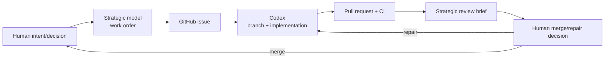

# OAP Workflow for This Repository

**Execution agent:** Codex programming agent, currently configured with ChatGPT-5.5-high
**Strategic layer:** long-context strategic model used by the human lead
**Durable truth:** GitHub repository, issues, PRs, CI, ADRs, and handoffs

## 1. Role separation

### Human lead

Owns:

- product intent and domain truth;
- acceptance/release criteria;
- privacy/security risk decisions;
- priority and scope;
- merge and deployment authority.

The human does not need to perform routine package installation, debugging commands, or repository edits for Codex.

### Strategic model

Owns advisory/control-plane work:

- architecture and stack decisions;
- discovery and risk register;
- issue-ready work orders;
- non-goals and evidence requirements;
- review of PR diff, CI, tests, migrations, docs, and reports;
- repair prompts;
- release decision briefs;
- project handoff updates.

The strategic model does not merge and is not the accountable release authority.

### Codex execution agent

Owns one bounded implementation task:

- inspect the live repository;
- install tools in its execution environment;
- edit files;
- run tests and local services;
- commit and push a branch;
- open a PR;
- return a structured evidence report.

Codex does not redefine the product, widen scope silently, merge, deploy, or touch production secrets.

## 2. Repository initialization

The constitution-and-design bundle is the one-time bootstrap PR. After it merges, `AGENTS.md` is the governing instruction source for Codex.

No executable application is claimed by the bootstrap PR. PR 1 is the first implementation PR and must establish a green scaffold and CI.

## 3. Standard work loop



### Step 1: verify current state

Before drafting work, the strategic model checks:

- default branch SHA and recent merges;
- open PRs and CI;
- current roadmap/handoff;
- relevant ADRs and outstanding findings.

A stale handoff never overrides the live repository.

### Step 2: create work-order issue

Use `.github/ISSUE_TEMPLATE/codex_work_order.yml`. The work order includes:

- current verified state;
- goal and domain behavior;
- scope;
- explicit non-goals;
- acceptance criteria;
- files/areas to inspect;
- tests and docs;
- allowed local setup;
- security/migration constraints;
- final report format.

The human approves the work order before execution.

### Step 3: Codex execution

Codex:

1. reads `AGENTS.md` and issue;
2. verifies current `main`;
3. creates `codex/<issue>-<name>`;
4. performs only scoped work;
5. runs focused then relevant full verification;
6. commits and pushes;
7. opens a PR linked to the issue;
8. fills the PR template with exact evidence;
9. does not merge.

Use a fresh or compacted execution context for each work order. One task should not depend on an agent remembering an earlier chat.

### Step 4: CI and executor report

CI results and the PR report are claims indexed to evidence. Failed, skipped, unrun, and blocked checks remain explicit.

If CI exposes a repair within scope, Codex may fix it on the same branch. If a fix changes architecture or scope, return to strategic review.

### Step 5: strategic review

Given a PR URL, the strategic model inspects:

- original issue/work order;
- changed filenames and diff;
- comments/review threads;
- workflow jobs and logs as needed;
- migrations and schema impact;
- test quality, not just status;
- documentation and readiness language;
- dependency/security impact;
- unrelated changes.

It returns:

```markdown
## Decision brief
Recommendation: merge / repair / reject / defer

### Goal match

### Evidence

### Risks and gaps

### Required repair, if any

### Human decision
```

### Step 6: repair or merge

- Repairs normally stay on the same PR branch.
- The strategic model turns findings into precise comments/work orders.
- Codex implements repair and updates evidence.
- A human maintainer merges only after acceptance.
- Squash merge is preferred unless preserving commits has a concrete value.

### Step 7: update continuity

After merge:

- close the work-order issue;
- update roadmap/handoff if milestone truth changed;
- record accepted ADRs;
- select the next smallest coherent task;
- discard/compact the Codex task context.

## 4. PR sizing rules

A good PR:

- implements one domain capability or foundation;
- is independently testable;
- leaves `main` deployable/testable at the claimed stage;
- avoids broad refactors;
- usually changes one architecture layer plus tests/docs;
- can be repaired without opening a second feature PR.

Split work when it combines, for example:

- schema plus full UI plus API plus deployment;
- authentication plus OIDC plus token management;
- reservation core plus gateway execution;
- migration tooling plus production cutover.

## 5. No concurrent feature pile-up initially

Until the architecture and CI stabilize:

- keep at most one broad implementation PR active;
- allow a second PR only when file/decision overlap is demonstrably absent;
- merge or close repair work before starting dependent features;
- do not ask multiple agents to invent the same domain model in parallel.

## 6. Evidence standards

Every PR should permit the strategic model to answer:

- Which requirement does this implement?
- Which files enforce it?
- Which test fails if it regresses?
- Which negative path was proven?
- What was not run?
- Did migrations or external interfaces change?
- Did any dependency or trust boundary change?
- Is documentation honest?

A PR URL and green badge alone are insufficient.

## 7. Verification-only tasks

Before milestone/release claims, create a verification-only issue:

- no edits;
- no branch or PR;
- run specified commands from a named commit in a clean environment;
- report exact results and blockers;
- classify result as `OK`, `FAIL`, or `ENVIRONMENT_BLOCKED`.

## 8. Audit cadence

Use a separate review pass/model or human specialist:

- after scaffold + reservation architecture exists;
- after authentication/token and conflict logic;
- before internal alpha;
- after remediation of high-risk findings;
- before production readiness claims.

Archive accepted findings in issues or a remediation matrix. Do not implement every audit suggestion blindly; classify it against current scope.

## 9. Branch and GitHub settings

`main` must be protected. Require:

- pull request;
- at least one human approval;
- required CI checks;
- resolved review conversations;
- no force push/delete;
- rules applied to administrators where feasible.

Codex must not possess authority to bypass these controls. See `docs/repository-settings.md`.

## 10. Prompting the Codex agent

The issue should be the primary task specification. A concise launch prompt is enough:

```text
Implement the approved work-order issue in ulfe-lmi/slaif-asset-reservation.
Read AGENTS.md first. Verify current main, create one scoped branch and PR,
run the required checks, fill the PR template with exact evidence, and do not merge.
```

Do not paste an uncontrolled broad conversation into the executor. Durable architecture belongs in repository docs; current work belongs in the issue.

## 11. Strategic continuity

`docs/project-handoff.md` is a compact memory aid. Update it at milestones or major architectural changes, not mechanically on every small PR. It never overrides the repository, PR history, or CI.
